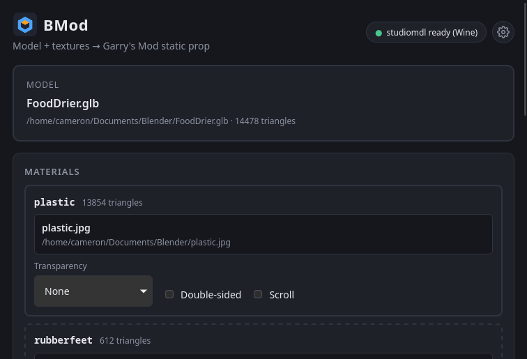
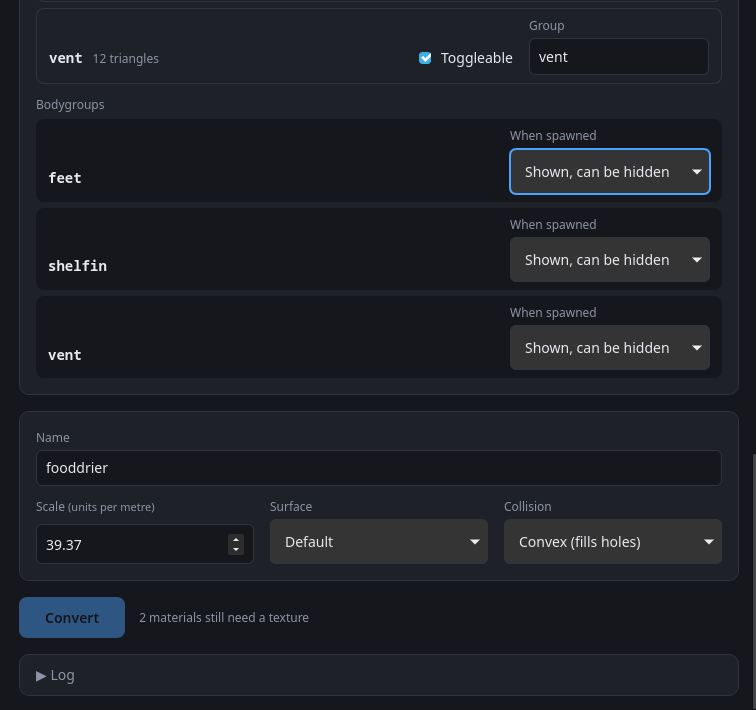
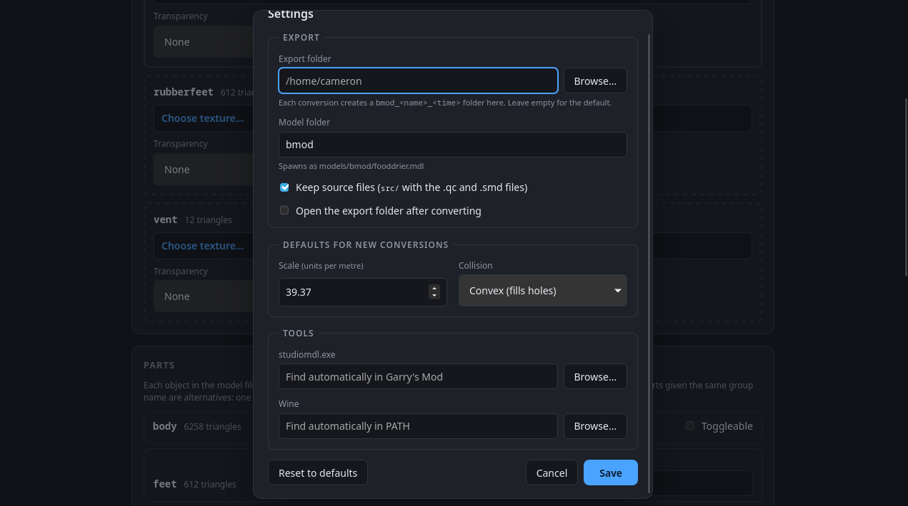

<div align="center">

</div>

# BMod

Blender-to-Garry's Mod, or BMod, is a simple GUI app for converting modern model files and an unwrapped texture into a Garry's Mod static prop: `.mdl` plus `.vtf`/`.vmt`.

<div align="center">
    
</div>

## Requirements

To use BMod you need:

- **Garry's Mod (Windows build)** installed through Steam. BMod uses its `bin/win64/studiomdl.exe`, or `bin/studiomdl.exe` (32-bit) if you pick it in Settings or the 64-bit one is missing. On Linux, force the Windows build with *Properties → Compatibility → Proton*.
- **Wine** on Linux and macOS, for running studiomdl. BMod uses its own prefix in the app data dir, for example `~/.local/share/bmod/wineprefix`.

BMod finds GMod through your Steam library folders. To override this, set the paths under **Settings** (the gear icon), or set:

| Variable         | Purpose                     |
|------------------|-----------------------------|
| `BMOD_STUDIOMDL` | Path to `studiomdl.exe`     |
| `BMOD_WINE`      | Path to the `wine` binary   |

Paths set in Settings take precedence over these variables.

## Building

BMod is a Cargo workspace with three crates: `bmod-core` (the conversion pipeline), `bmod-cli` (headless front-end) and `bmod` in `src-tauri` (the GUI). The frontend in `ui/` is plain HTML/CSS/JS, so there is no npm or bundler step.

### Prerequisites

- **Rust** (stable), installed with [rustup](https://rustup.rs).
- The [Tauri 2 system dependencies](https://v2.tauri.app/start/prerequisites/) for your OS. On Linux these are `webkit2gtk-4.1` and `gtk3`. On Windows, the WebView2 runtime is needed to run the GUI. Windows 10 and 11 already include it.
- **Tauri CLI**, only for building installers: `cargo install tauri-cli --locked`.

### Run from source

```sh
cargo run -p bmod                       # GUI
cargo run -p bmod-cli -- --help         # CLI (see Command line below)
```

### Release build

Build on the OS you are targeting:

```sh
cargo build --release
```

| Output | Path |
|---|---|
| GUI | `target/release/bmod` (`bmod.exe` on Windows) |
| CLI | `target/release/bmod-cli` (`bmod-cli.exe` on Windows) |

To build only one of them, add `-p bmod` or `-p bmod-cli`.

### Installers

Installers (AppImage/deb/rpm on Linux, NSIS/MSI on Windows, dmg on macOS) need the Tauri CLI. Run this from the repo root:

```sh
cargo tauri build
```

Installers are written to `target/release/bundle/<format>/`. To build a single format, add `--bundles`, for example `--bundles nsis`.

### Cross-compiling for Windows from Linux

[`cargo-xwin`](https://github.com/rust-cross/cargo-xwin) downloads the MSVC CRT and Windows SDK and cross-compiles with clang and lld. Wine isn't needed to build.

1. **One-time setup**

   ```sh
   rustup target add x86_64-pc-windows-msvc
   cargo install cargo-xwin --locked
   sudo pacman -S clang lld llvm          # Arch. On other distros, install clang, lld and llvm
   ```

   The first build downloads about 1 GB of SDK files into `~/.cache/cargo-xwin`.

2. **Build the executables (GUI and CLI)**

   ```sh
   cargo xwin build --release --target x86_64-pc-windows-msvc
   ```

   The output is in `target/x86_64-pc-windows-msvc/release/`: `bmod.exe` (GUI) and `bmod-cli.exe` (CLI). Add `-p bmod` or `-p bmod-cli` to build only one.

3. **Build the installer (optional)**

   Cross-compiled installers use NSIS. MSI can't be built on Linux. You also need `makensis` (`sudo pacman -S nsis`) and the Tauri CLI (see Prerequisites).

   ```sh
   cargo tauri build --runner cargo-xwin --target x86_64-pc-windows-msvc --bundles nsis
   ```

   The setup file is written to `target/x86_64-pc-windows-msvc/release/bundle/nsis/`. Without `--bundles nsis`, Tauri also tries to build Linux formats.

Testing the result: the CLI usually runs under Wine, but the Tauri GUI doesn't run reliably there, so test the GUI on a real Windows machine or VM.

### Versioning

The version is set in `src-tauri/tauri.conf.json` and in each crate's `Cargo.toml`. It determines the installer's filename and the version the app reports. Update all of them before tagging a release.

## Command line

```sh
cargo run -p bmod-cli -- model.glb --list            # show material slots
cargo run -p bmod-cli -- model.glb texture.png       # one texture for every slot
cargo run -p bmod-cli -- printer.glb --tex body=body.png --tex money=money.png \
    --scroll money=0.5:90 --name money_printer       # per-slot textures + scrolling
cargo run -p bmod-cli -- cup.glb cup.png --concave   # collision that keeps the cup's mouth open
cargo run -p bmod-cli -- printer.glb body.png --group screen=screen      # screen part can be switched off
cargo run -p bmod-cli -- hat.glb hat.png --group hat=cap,tophat:hidden   # spawns bare; pick a cap or top hat
cargo run -p bmod-cli -- model.glb texture.png --fast-textures  # quicker, slightly lower-quality textures
cargo run -p bmod-cli -- model.glb texture.png --chunks 16      # split a big model further for a faster compile
cargo run -p bmod-cli -- --help                      # all options (--out, --model-dir, --no-sources, --no-cache, …)
```

With a release build, run the binary directly instead of `cargo run`, for example `bmod-cli model.glb texture.png`.

## Usage

1. Drop or browse a model (`.glb`, `.gltf`, `.obj`). BMod lists its material slots.
2. Give each slot a texture (`.png`, `.jpg`, `.tga`, …) by clicking it or dropping an image onto it. Images dropped elsewhere fill the first empty slot.
3. For each slot, set transparency, double-sided, and **Scroll** (speed in texture-widths per second, and angle) as needed.
4. Optionally, make some **Parts** toggleable (see [Bodygroups](#bodygroups)).
5. Set the name, scale, surface type and collision, then click **Convert**. A folder named `bmod_<name>_<timestamp>/` appears in the export folder (the working directory unless changed in Settings):

```text
models/bmod/<name>.mdl  (.vvd .phy .dx90.vtx, plus .dx80.vtx with fast compile off)
materials/models/bmod/<name>/<slot>.vmt   one per material slot
materials/models/bmod/<name>/<slot>.vtf   one per distinct texture file
src/            generated .qc and .smd files, kept for reference
```

<div align="center">
    
</div>

### Bodygroups

Each object in the model file (each Blender object) is a **part**. By default every part is always shown. Tick **Toggleable** on a part to put it in a bodygroup, which you can switch in-game from the context menu (**Bodygroups**) or with `Entity:SetBodygroup`.

- A toggleable part gets a group named after it. Give several parts the same group name to make them alternatives: one shows at a time, in model order. Examples are a cap and a top hat in a `hat` group.
- **When spawned** sets the group's starting state. *Shown, can be hidden* adds an empty option after the parts. *Hidden, can be shown* adds it before them. *Shown, can't be hidden* has no empty option, for alternatives where one must always show.
- Collision does not change with bodygroups. It covers the parts that are visible when the prop spawns.

### Scrolling textures

Scrolling applies to a whole material, so give the moving part its own material in Blender, such as the money strip on a money printer. Make its texture tile seamlessly in the scroll direction. BMod writes a `TextureScroll` proxy on `$basetexturetransform`. If it scrolls the wrong way in-game, flip the angle (for example, 90 to -90).

Copy that folder into `garrysmod/addons/`. The prop then spawns as `models/bmod/<name>.mdl`.

### Settings

The gear icon opens global settings, saved in BMod's config directory (for example `~/.config/dev.bmod.app/settings.json`):

- **Export folder:** where output folders are created. Pointing it at `garrysmod/addons/` skips the copy step.
- **Model folder:** replaces `bmod` in `models/bmod/` and `materials/models/bmod/`.
- **Keep source files:** keeps the generated `src/` folder. Turn it off for cleaner addons.
- **Open the export folder after converting.**
- **Fast texture compression:** encodes large textures roughly 10x faster at slightly lower quality (more visible blockiness on smooth gradients). Worth turning on while iterating; turn it off for the final export.
- **Defaults** for scale and collision on new conversions.
- **Compiling:** speed options for studiomdl, which is the slow step on big models.
  - **Fast compile** (on by default) skips the DirectX 8 mesh (`.dx80.vtx`), which Garry's Mod doesn't use. It about halves compile time, and the other files come out identical.
  - **studiomdl build** picks the 64-bit or 32-bit studiomdl from Garry's Mod. BMod detects both and uses 64-bit by default, since it is faster. If only one is installed, that one is used.
  - **Chunks** (1, 4, 8, 16 or 32; default 8) splits the always-visible geometry into up to that many body parts. studiomdl slows down sharply as one mesh grows, so a 100,000-triangle model compiles in about 12 s with 8 chunks instead of about a minute with 1. Each chunk keeps at least 2,000 triangles, so small models aren't split, and bodygroups use up chunk slots (Source allows 32 body parts in total). Chunks have one option each, so they don't appear in GMod's bodygroup menu, and they come after your bodygroups so bodygroup numbers don't change. Each extra chunk adds a draw call in-game.
- **Tools:** paths to `studiomdl.exe` and Wine when auto-detection fails.
- **Texture cache:** shows where cached textures live and how much space they use, with buttons to open the folder or clear it (see below).

<div align="center">
    
</div>

### Texture cache

Encoding a large texture takes a few seconds, so BMod keeps a copy of every texture it encodes and reuses it when you convert again with the same image (the log says "reused from cache"). Entries are matched by the image's contents, so editing a texture, even under the same file name, re-encodes it.

The cache lives in your user cache folder:

| OS | Location |
|---|---|
| Linux | `~/.cache/bmod/textures` |
| Windows | `%LOCALAPPDATA%\bmod\cache\textures` |
| macOS | `~/Library/Caches/bmod/textures` |

It is capped at 1 GB; the least recently used textures are deleted first. To free the space, use **Clear cache** in Settings or delete the folder. Either is safe: textures are just encoded again on the next conversion. The CLI uses the same cache; pass `--no-cache` to skip it.

### Collision

- **Convex** (default) wraps the whole model in one hull. It is cheap and stable, but it fills in holes: a cup gets an invisible lid.
- **Concave** splits the model into up to 32 convex pieces (V-HACD) and compiles them with `$concave`. Openings, hollows and gaps stay open, so things can go inside a cup or box. A closed mesh inside the model, such as liquid in a cup, still counts as solid.

### Preparing the model in Blender

- Join everything that should always be visible into one object (Ctrl+J). Keep parts you want to toggle as separate objects. Use one UV map, with all transforms applied (Ctrl+A). Use one material per texture, up to 32. Material names become the slot names.
- Export as **glTF 2.0 (.glb)**. The default scale of 39.37 turns Blender metres into Source units, which are roughly inches.
- Use power-of-two textures, such as 1024×1024. Other sizes are resized automatically.

## v1 scope

- Static props only: no bones, animations or LODs.
- Textures can scroll but not flip through frames. There are no animated VTFs yet.
- Collision is either one convex hull or an automatic convex decomposition. You can't supply a custom collision mesh yet.
- The texture is DXT1, or DXT5 when it has alpha, with full mipmaps. There are no normal maps yet.

## Layout

```text
crates/bmod-core   conversion pipeline (import, SMD, QC, VTF/VMT, collision, studiomdl runner)
crates/bmod-cli    headless front-end
src-tauri          Tauri app shell
ui                 frontend (plain HTML/CSS/JS, no build step)
tests/fixtures     sample cube and two-part money printer (regenerate with generate.py)
```
