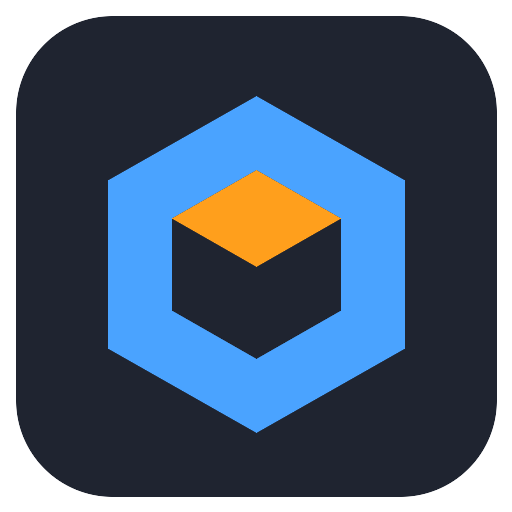

<div align="center">

</div>

# BMod

Blender-to-Garry's Mod, or BMod, is a simple GUI app for converting modern model files and an unwrapped texture into a Garry's Mod static prop: `.mdl` plus `.vtf`/`.vmt`.

## Requirements

- **Rust** (stable) and the [Tauri 2 system dependencies](https://v2.tauri.app/start/prerequisites/). On Linux these are `webkit2gtk-4.1` and `gtk3`.
- **Garry's Mod (Windows build)** installed through Steam. BMod uses its `bin/studiomdl.exe`. On Linux, force the Windows build with *Properties → Compatibility → Proton*.
- **Wine** on Linux and macOS, for running studiomdl. BMod uses its own prefix in the app data dir, for example `~/.local/share/bmod/wineprefix`.

BMod finds GMod through your Steam library folders. To override this, set the paths under **Settings** (the gear icon), or set:

| Variable         | Purpose                     |
|------------------|-----------------------------|
| `BMOD_STUDIOMDL` | Path to `studiomdl.exe`     |
| `BMOD_WINE`      | Path to the `wine` binary   |

Paths set in Settings take precedence over these variables.

## Run

```sh
cargo run -p bmod                                    # GUI
cargo run -p bmod-cli -- model.glb --list            # show material slots
cargo run -p bmod-cli -- model.glb texture.png       # one texture for every slot
cargo run -p bmod-cli -- printer.glb --tex body=body.png --tex money=money.png \
    --scroll money=0.5:90 --name money_printer       # per-slot textures + scrolling
cargo run -p bmod-cli -- cup.glb cup.png --concave   # collision that keeps the cup's mouth open
cargo run -p bmod-cli -- printer.glb body.png --group screen=screen      # screen part can be switched off
cargo run -p bmod-cli -- hat.glb hat.png --group hat=cap,tophat:hidden   # spawns bare; pick a cap or top hat
cargo run -p bmod-cli -- --help                      # all options (--out, --model-dir, --no-sources, …)
```

Bundling installers (AppImage/deb/MSI) needs the Tauri CLI: `cargo install tauri-cli`, then `cargo tauri build`.

## Usage

1. Drop or browse a model (`.glb`, `.gltf`, `.obj`). BMod lists its material slots.
2. Give each slot a texture (`.png`, `.jpg`, `.tga`, …) by clicking it or dropping an image onto it. Images dropped elsewhere fill the first empty slot.
3. For each slot, set transparency, double-sided, and **Scroll** (speed in texture-widths per second, and angle) as needed.
4. Optionally, make some **Parts** toggleable (see [Bodygroups](#bodygroups)).
5. Set the name, scale, surface type and collision, then click **Convert**. A folder named `bmod_<name>_<timestamp>/` appears in the export folder (the working directory unless changed in Settings):

```text
models/bmod/<name>.mdl  (.vvd .phy .dx80.vtx .dx90.vtx)
materials/models/bmod/<name>/<slot>.vmt   one per material slot
materials/models/bmod/<name>/<slot>.vtf   one per distinct texture file
src/            generated .qc and .smd files, kept for reference
```

### Bodygroups

Each object in the model file (each Blender object) is a **part**. By default every part is always shown. Tick **Toggleable** on a part to put it in a bodygroup, which you can switch in-game from the context menu (**Bodygroups**) or with `Entity:SetBodygroup`.

- A toggleable part gets a group named after it. Give several parts the same group name to make them alternatives: one shows at a time, in model order. Examples are a cap and a top hat in a `hat` group.
- **When spawned** sets the group's starting state. *Shown, can be hidden* adds an empty option after the parts. *Hidden, can be shown* adds it before them. *Shown, can't be hidden* has no empty option, for alternatives where one must always show.
- Collision does not change with bodygroups. It covers the parts that are visible when the prop spawns.

### Scrolling textures

Scrolling applies to a whole material, so give the moving part its own material in Blender, such as the money strip on a money printer. Make its texture tile seamlessly in the scroll direction. BMod writes a `TextureScroll` proxy on `$basetexturetransform`. If it scrolls the wrong way in-game, flip the angle (for example, 90 to -90).

Copy that folder into `garrysmod/addons/`. The prop then spawns as `models/bmod/<name>.mdl`.

### Settings

The gear icon opens global settings, saved in BMod's config directory (for example `~/.config/dev.bmod.app/settings.json`):

- **Export folder:** where output folders are created. Pointing it at `garrysmod/addons/` skips the copy step.
- **Model folder:** replaces `bmod` in `models/bmod/` and `materials/models/bmod/`.
- **Keep source files:** keeps the generated `src/` folder. Turn it off for cleaner addons.
- **Open the export folder after converting.**
- **Defaults** for scale and collision on new conversions.
- **Tools:** paths to `studiomdl.exe` and Wine when auto-detection fails.

### Collision

- **Convex** (default) wraps the whole model in one hull. It is cheap and stable, but it fills in holes: a cup gets an invisible lid.
- **Concave** splits the model into up to 32 convex pieces (V-HACD) and compiles them with `$concave`. Openings, hollows and gaps stay open, so things can go inside a cup or box. A closed mesh inside the model, such as liquid in a cup, still counts as solid.

### Preparing the model in Blender

- Join everything that should always be visible into one object (Ctrl+J). Keep parts you want to toggle as separate objects. Use one UV map, with all transforms applied (Ctrl+A). Use one material per texture, up to 32. Material names become the slot names.
- Export as **glTF 2.0 (.glb)**. The default scale of 39.37 turns Blender metres into Source units, which are roughly inches.
- Use power-of-two textures, such as 1024×1024. Other sizes are resized automatically.

## v1 scope

- Static props only: no bones, animations or LODs.
- Textures can scroll but not flip through frames. There are no animated VTFs yet.
- Collision is either one convex hull or an automatic convex decomposition. You can't supply a custom collision mesh yet.
- The texture is DXT1, or DXT5 when it has alpha, with full mipmaps. There are no normal maps yet.

## Layout

```text
crates/bmod-core   conversion pipeline (import, SMD, QC, VTF/VMT, collision, studiomdl runner)
crates/bmod-cli    headless front-end
src-tauri          Tauri app shell
ui                 frontend (plain HTML/CSS/JS, no build step)
tests/fixtures     sample cube and two-part money printer (regenerate with generate.py)
```
